# score_lib

score_lib is a free library of 3D parts for building virtual places: models, surfaces, kit pieces, characters,
sounds, effects, lights and the code that makes them. [SCORE](https://github.com/Babon-Innovations-b-v/score) builds every
place it makes from these parts. Everything here is MIT, so you may use it for anything, except
parts from a source that keeps its own licence: each such entry names that licence and the credit it asks for, and
you keep both when you use it.

The records (what each entry is, where it came from, the hash of every file) live in this repository. The bytes
live in a public Hugging Face dataset.

## What is in it

| kind | entries | one entry is |
|---|---:|---|
| model | 2,097 | one 3D object, such as a rover, a chair or a lamp |
| kit | 707 | one building piece, such as a wall panel, a door frame or a pipe |
| take | 458 | one picture-to-3D take whole, with the close-up it was made from |
| surface | 423 | one finish: a material and its maps |
| sound | 166 | one sound source and its recordings |
| effect | 104 | one effect, such as steam, dust or sparks, with its baked clip |
| character | 81 | one body or dress, rigged |
| algorithm | 39 | one piece of engine code, with its settings and tests |
| concept | 25 | one place's locked concept picture |
| place | 10 | one whole place, laid from library entries |
| light | 4 | one light, such as a sky or the library lamp |

Counts are entry folders, withdrawn versions included: a withdrawn entry keeps its record so it stays traceable.

## One of each

| | | |
|:-:|:-:|:-:|
| 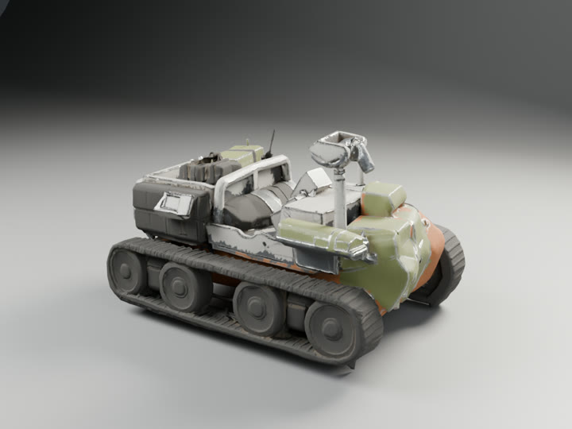<br>**model** `model/rover_1.old_station@1` | 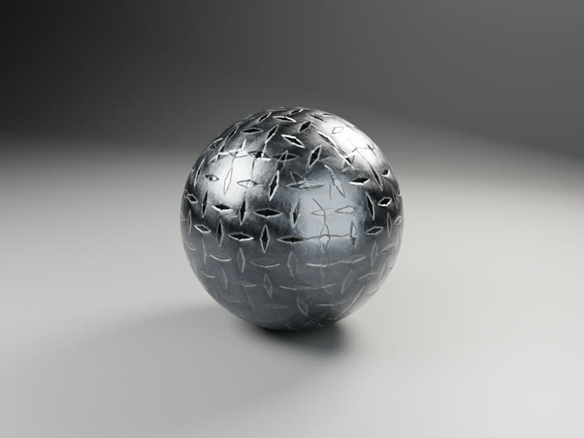<br>**surface** `surface/ambientcg_metalplates006@1` on a sphere | 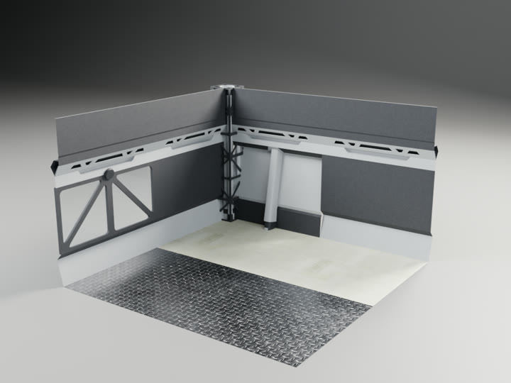<br>**kit** `kit/quaternius_scifi_door_frame_a@1`, finished with `surface/ambientcg_paintedmetal006@1` |
| 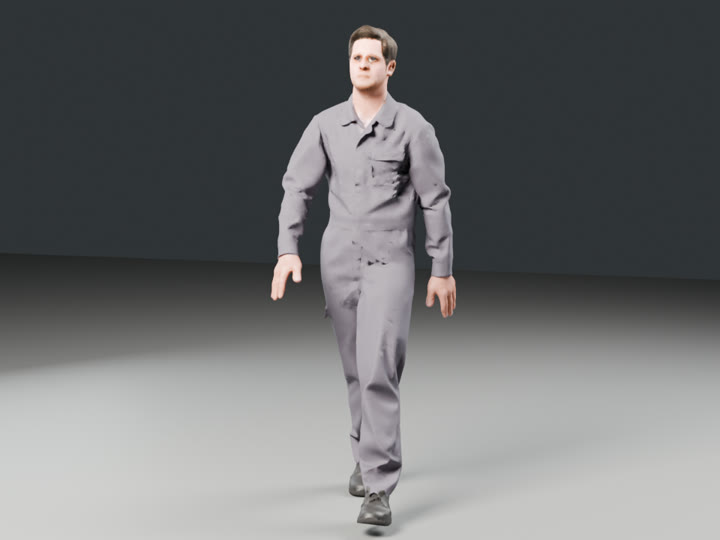<br>**character** `character/woman_stair_trellis@1` | 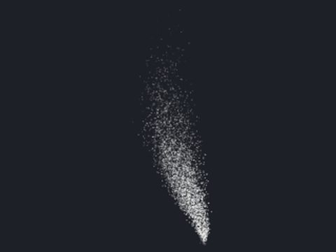<br>**effect** `effect/kettle_1_steam_jet@1` | 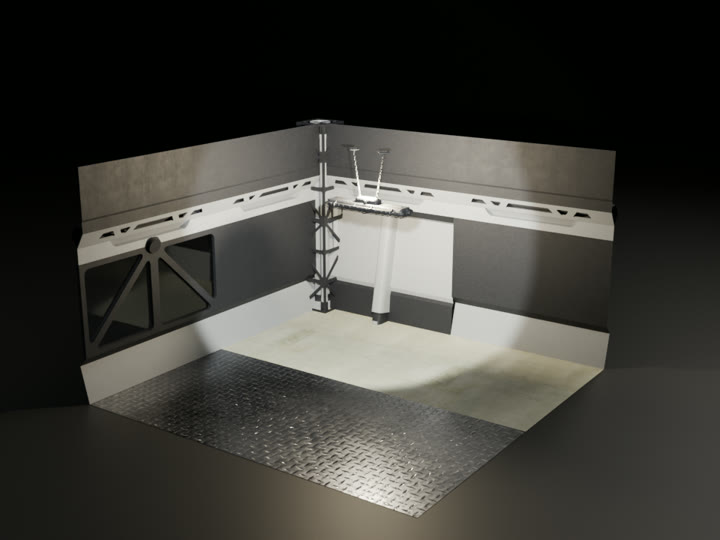<br>**light** `light/lamp@1`: its ceiling lamp and 46° aimed spot on a kit piece |
| 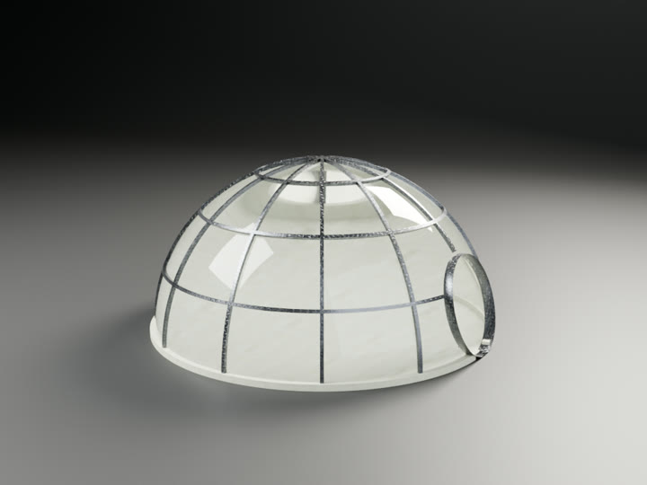<br>**algorithm** a ribbed glass dome made by `algorithm/dome_shell@1` | 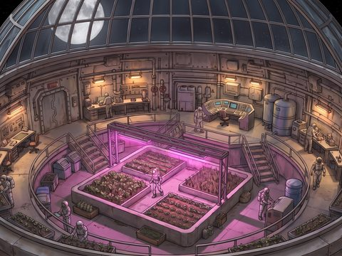<br>**concept** `concept/greenhouse@1` | 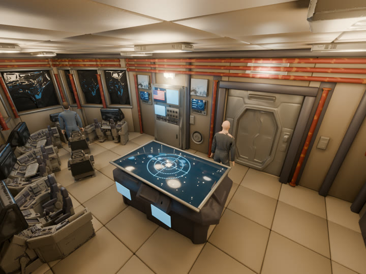<br>**place** `place/greenhouse@1`, rendered |
| 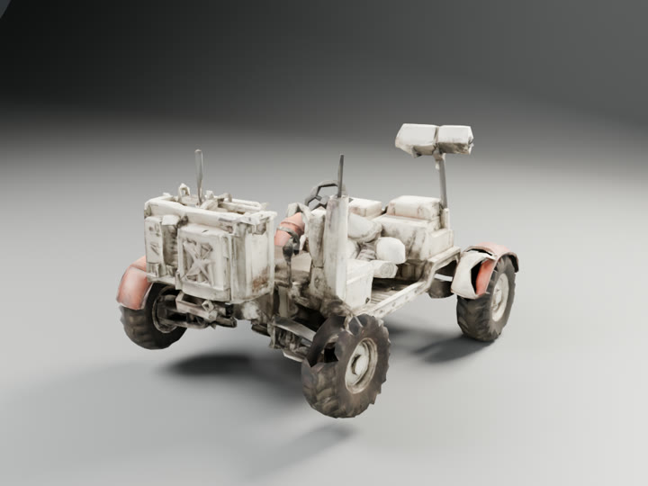<br>**take** `take/garage_rover_chassis_b26f85f9@1` | 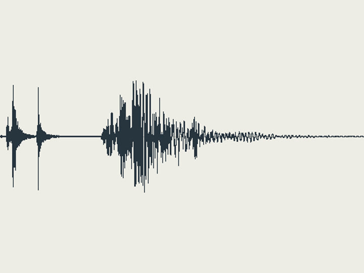<br>**sound** `sound/hatch_open@2` | |

Every picture is made from the entry's own files: the 3D ones rendered in Blender, the sound drawn from its samples.

## Get an entry

No account or key is needed.

```
uv sync
SCORE_LIB_HUB_REPO=Babon-Innovations-b-v/score-lib uv run score-lib fetch model/rover_1.old_station@1 --into parts
```

The files land in `parts/score_lib/model/rover_1.old_station/1/`. Add `--with-requires` to fetch what an entry needs
too. Paths inside entries are USD search paths, so `PXR_AR_DEFAULT_SEARCH_PATH=parts usdview <file>` opens one as is.

## Add your own

See [CONTRIBUTING.md](CONTRIBUTING.md). In short: your own work or CC0, no people or logos, and we suggest doing it
with a coding agent.

## For maintainers

The full command list is `uv run score-lib --help`. The rules for working in this repository are in `CLAUDE.md`.

```
score-lib export --world world1 [--kind k] [--place p] [--dry-run] [--report <file>]
score-lib lock <address>... | --all-drafts --kind k
score-lib withdraw <address>
score-lib fetch <address>... --into <root> [--with-requires] [--file <name>]...
score-lib take-in <list.json> [--report <file>] | --place <place_build folder> --commit <score sha> [--save]
score-lib bundle <address>... --out <name>.tgz
score-lib review --base origin/main --contributor <handle> --bundle <url> --sheet <sheet.png>
score-lib take-bundle <url>... --pr <n> --contributor <handle> --commit <sha> [--save]
score-lib trace <address | sha256 | handle:<h> | source:<id> | pr:<n>>
score-lib test algorithm/<name>@<v> [--score <score checkout>] | run algorithm/<name>@<v> ...
score-lib index | verify [--deep] [--address a] | quality | audit | web3d | page | handover | held | concept
score-lib hub-mirror <owner/name> [--check-only]
```

- The blob store is set by environment variables only (`config/blobstore.env.template`): a local folder, an
  S3-compatible store, or the Hugging Face dataset (`SCORE_LIB_HUB_REPO`, read with no key). With none set, a command
  that only reads (fetch, test, run, verify) reads the public copy `config/public_store.toml` names.
- `test` runs an algorithm's tests in a throwaway Python with its requirements (uv); `--score <score checkout>`
  (default `SCORE_REPO`) lays in the code the library may not carry (`code.json`'s `left_out`), checked by sha256.
- `export` and `handover` read a SCORE store (`SCORE_STORE`) and the score repository (`SCORE_REPO`) and never
  write to either. `handover` is the one call score's runner makes when a place is accepted.
- `take-in` takes loose made files in as draft entries; `take-in --place` takes in a place built by score's placing
  method.
- `quality` gives every entry a score from 0 to 100 from free local measures (`src/score_lib/quality/<kind>.py`).
- `web3d` gives model, kit, character and place entries compressed glTF copies for a web viewer.
- A locked entry never changes; a change becomes the next version as a draft.

Layout: `entries/<kind>/<id>/<version>/entry.json` is the record, `index/` is built from it, `definitions/` holds
the algorithm definitions and `config/sources.toml` lists every source an entry's content may come from.

## Licence

MIT (`LICENSE`), the bytes included. Nothing that cannot be released under MIT is let in. Each entry names what made
it in `provenance.made_with`, each source with its row in `config/sources.toml`. Code whose terms require keeping its
own licence (BSD-3-Clause, GPL, the SIL Open Font License) is never copied in; an algorithm names it as an outside
requirement instead.

## Tests

```
uv run pytest
```
